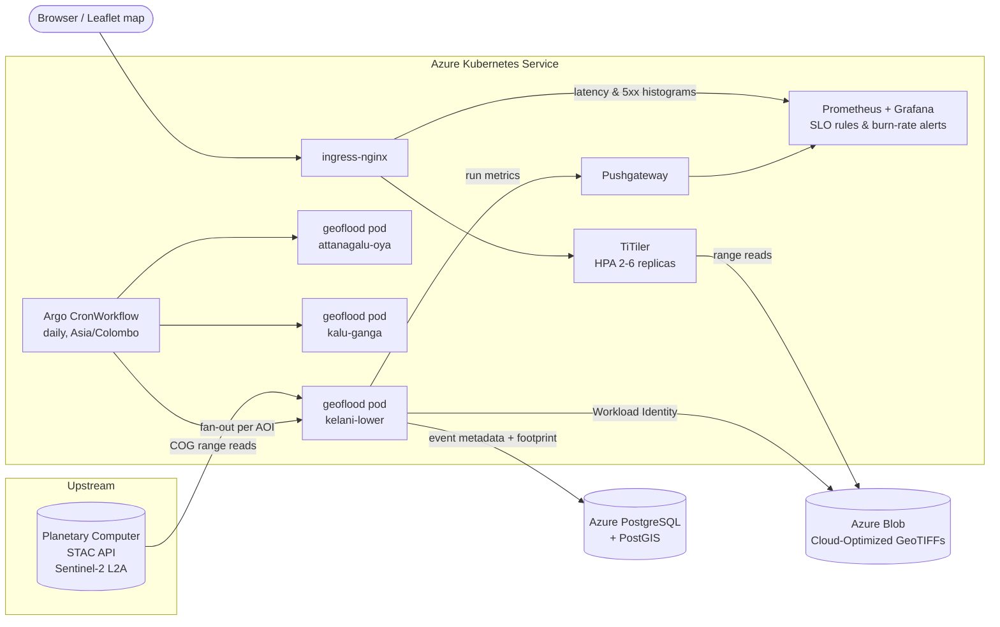

# Geo Flood Monitor

[](https://github.com/sanduniwwijesinghe/geo-flood-monitor/actions/workflows/ci.yml)

A cloud-native pipeline that detects **flood extent in Sri Lankan river basins** from free
Sentinel-2 satellite imagery. It runs on **Azure Kubernetes Service**, serves the results as
web-map tiles, and is operated against explicit **SLOs**.

Sri Lanka's western river basins (Kelani Ganga, Attanagalu Oya, Kalu Ganga) flood almost every
monsoon. This project compares the newest satellite pass with a dry-season baseline and maps
**new water**, so you can see within hours of an overpass where the river has spread.

## Architecture



Batch jobs run on a **spot node pool that autoscales from zero**, so imagery processing costs
only what it uses. The tile service runs on the system pool with an HPA and a PodDisruptionBudget.

## How detection works

1. **Scene discovery** - query the STAC API for the newest Sentinel-2 L2A scene over the AOI
   (cloud cover < 40 %), then the clearest **dry-season baseline** (Feb-Mar) **on the same MGRS
   tile**, so both share the same 10 m pixel grid.
2. **Windowed COG reads** - only the AOI window of each band is fetched over HTTP range
   requests (Green B03, NIR B08 at 10 m; Scene Classification SCL at 20 m, resampled).
3. **Radiometric harmonisation** - removes the `-1000` BOA offset that applies to
   processing baseline 04.00+ scenes, so old and new scenes are comparable.
4. **Water index** - NDWI = (Green - NIR) / (Green + NIR); water > 0.
5. **Cloud masking** - SCL classes cloud / shadow / cirrus / saturated are excluded.
6. **Change detection** - each pixel becomes `0` dry, `1` permanent water, `2` **new flood
   water**, or `255` no data.
7. **Outputs** - a Cloud-Optimized GeoTIFF with an embedded colour table (Blob), a row in
   PostGIS with flooded km² and footprint geometry, and metrics to Prometheus.

## Repository layout

```
src/geoflood/          Python pipeline (STAC search, raster I/O, indices, sinks, metrics, CLI)
tests/                 Unit tests + an end-to-end test on synthetic Sentinel-2 rasters
infra/terraform/       AKS (workload identity, spot pool), ACR, Storage, PostGIS, Log Analytics
deploy/helm/           Chart: TiTiler, Argo CronWorkflow, RBAC, PrometheusRule, Grafana dashboard
deploy/bootstrap.sh    Installs ingress-nginx, kube-prometheus-stack, Argo, then the chart
monitoring/            Prometheus rules for running the stack locally
viewer/                Minimal Leaflet map for viewing results
docs/runbook.md        SLO definitions and alert runbooks
```

## Run locally

Requirements: Docker, Python 3.11+.

```bash
make install && make test            # unit + end-to-end tests, no network needed
make local-up                        # PostGIS, TiTiler, Pushgateway, Prometheus
make local-run AOI=kelani-lower      # analyse the latest pass over the lower Kelani
```

Analyse a past flood event by date, e.g. the June 2024 south-west monsoon floods:

```bash
docker compose run --rm pipeline run --aoi kelani-lower --date 2024-06-05 --lookback-days 7
```

Open `viewer/index.html`, keep TiTiler at `http://localhost:8000`, and enter
`/data/<output-file>.tif`. Red = new flood water, blue = permanent water.
Prometheus is at http://localhost:9090 (`geoflood_flooded_area_km2`).

## Deploy to Azure

```bash
cd infra/terraform
cp terraform.tfvars.example terraform.tfvars      # set subscription_id
cp backend.hcl.example backend.hcl                # remote state in Azure Storage
terraform init -backend-config=backend.hcl
terraform plan -out=tfplan && terraform apply tfplan
cd ../.. && ./deploy/bootstrap.sh
```

`bootstrap.sh` prints the tile endpoint (`http://tiles.<lb-ip>.nip.io`). Trigger a run without
waiting for the schedule:

```bash
argo submit --from cronwf/geoflood-pipeline -n geoflood --watch
```

Tear down with `terraform destroy` when finished.

## SLOs

| SLO | Target | How it is measured |
|---|---|---|
| Freshness | Every AOI analysed within 26 h | `geoflood_last_success_timestamp_seconds` from the Pushgateway |
| Tile latency | 99 % of tile requests < 500 ms over 30 d | ingress-nginx request duration histogram |
| Tile availability | 99.5 % non-5xx over 30 d | ingress-nginx request counter |

Tile SLOs use **multi-window, multi-burn-rate alerts** (14.4x over 1h & 5m pages; 6x over 6h & 30m
tickets) following the Google SRE Workbook. Each alert links to [the runbook](docs/runbook.md).

## CI/CD

GitHub Actions on every push and PR:

- **python** - ruff lint/format, pytest
- **terraform** - `fmt -check`, `validate`, Checkov IaC scan
- **helm** - `helm lint`, render, kubeconform schema validation (including Argo and Prometheus CRDs)
- **image** - build, smoke test, Trivy scan (fails on fixable HIGH/CRITICAL), push to GHCR on `main`

## Design decisions

- **Same MGRS tile for event and baseline**: avoids reprojecting either scene, so pixels line up
  exactly and the change map is free of resampling artefacts.
- **COG + TiTiler instead of pre-rendered tiles**: no tile cache to rebuild per run, and
  overviews keep low zoom levels fast.
- **Pushgateway for batch metrics**: the jobs end before Prometheus could scrape them.
  Freshness is alerted on *last success timestamp*, not on job failures, which catches missed
  schedules as well as crashes.
- **Workload Identity, shared keys disabled**: no storage keys exist anywhere in the cluster.
- **Public-read COG container**: flood maps are public information, so anonymous read lets
  TiTiler and browsers fetch tiles directly. Writes still require Entra ID.
- **Spot nodes with `retryPolicy: Always`**: an evicted pod is retried with backoff.

## Limitations and next steps

- Optical imagery cannot see through monsoon cloud. **Sentinel-1 SAR** (radar) water detection
  would give all-weather coverage and is the next planned addition.
- NDWI threshold is a fixed 0.0; Otsu thresholding per scene would adapt better to turbid water.
- An AOI must sit inside a single MGRS tile; mosaicking across tiles is not implemented yet.
- PostGIS currently uses public access with an Azure-services firewall rule; production should
  use VNet integration / Private Link.

## Data

Contains modified Copernicus Sentinel data, accessed via the
[Microsoft Planetary Computer](https://planetarycomputer.microsoft.com/). Basemap © OpenStreetMap
contributors.

## License

MIT
